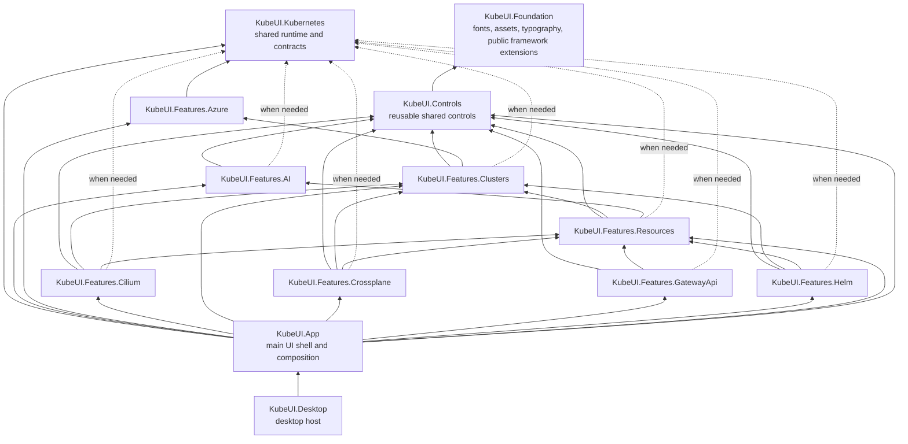

# Superseded architecture document

This project-structure plan is superseded. Current project ownership and dependency rules live in [ownership-map.md](ownership-map.md); prioritized remaining work lives in [remaining-work.md](remaining-work.md).

**Rename:** `KubeUI.Avalonia` was renamed to `KubeUI.Foundation` (project, assembly, and namespaces). The old name collided with the global `Avalonia` namespace: inside any `KubeUI.*` namespace, cref resolution bound the first `Avalonia` segment to `KubeUI.Avalonia`, breaking XML doc crefs. `tests/KubeUI.Avalonia.Tests` keeps its name; it is the cross-feature test hub, not a test project for this assembly alone.

## Goal

Split the current `KubeUI.Foundation` project into a stable Avalonia foundation, a shared control library, and feature projects. Keep one project per feature. Do not create paired `Core` and `UI` projects for each feature.

Feature projects should use reusable controls from `KubeUI.Controls` by default. A feature should own a local control when its behavior or presentation belongs only to that feature.

## Current state

The split is implemented. `KubeUI.Foundation` owns shared framework packages, fonts, assets, resources, typography, and the public Avalonia extension provider. `KubeUI.Controls` owns reusable UI primitives. `KubeUI.App` owns the shell, cross-feature composition, and application theme composition. Feature views, view models, services, assets, and resources live in their matching `KubeUI.Features.*` projects. `KubeUI.AI` and `KubeUI.Cilium` were renamed to `KubeUI.Features.AI` and `KubeUI.Features.Cilium`.

`KubeUI.Kubernetes` remains the shared Kubernetes runtime and contracts project. Azure authentication and management-plane integrations live in `KubeUI.Features.Azure`; cluster-management UI and AKS import workflow live in `KubeUI.Features.Clusters`. Feature tests live in dedicated test projects, with common setup shared through `KubeUI.Testing` and `tests/FeatureTests.props`. `KubeUI.Avalonia.Tests` retains App-shell, Controls, Desktop-startup, and cross-feature tests.

## Target projects

```text
src/
├── KubeUI.Kubernetes/              # Shared Kubernetes runtime and contracts
├── KubeUI.Foundation/                # Avalonia foundation, fonts, assets, typography
├── KubeUI.Controls/                # Reusable controls and shared UI contracts
├── KubeUI.Features.AI/             # AI runtime, views, view models, local controls
├── KubeUI.Features.Azure/          # Azure authentication and management-plane integrations
├── KubeUI.Features.Cilium/         # Cilium runtime, views, view models, local controls
├── KubeUI.Features.Clusters/       # Cluster workspace and cluster management UI
├── KubeUI.Features.Crossplane/     # Crossplane feature
├── KubeUI.Features.GatewayApi/     # Gateway API feature
├── KubeUI.Features.Helm/           # Helm feature
├── KubeUI.Features.Resources/      # Resource lists, details, YAML, visualizations
├── KubeUI.App/                     # Main UI shell, navigation and app composition
└── KubeUI.Desktop/                 # Desktop executable, platform startup and output
```



`KubeUI.Foundation` must not reference feature projects. `KubeUI.Controls` is the only project allowed to reference the foundation. App and feature projects do not add a project reference to the foundation; they keep direct NuGet references to Avalonia APIs and generators they compile against. Desktop references App only; App owns Kubernetes and feature composition. Feature projects may reference `KubeUI.Kubernetes` when they use its runtime or contracts. A feature may reference another feature when it consumes an owned capability; keep those edges minimal and acyclic. `KubeUI.Features.Azure` owns Azure SDK integrations and depends on Kubernetes serialization contracts; Clusters owns the AKS import workflow and consumes Azure services. `KubeUI.Features.Clusters` owns cluster-workspace contracts, and `KubeUI.Features.Resources` depends on Clusters to implement resource configuration. Clusters must not reference Resources.

## Namespace conventions

Keep project and assembly names concise. Group feature namespaces below `KubeUI.Features` so their public types do not all sit directly below `KubeUI`:

- `KubeUI.Features.AI` project: `KubeUI.Features.AI.*`
- `KubeUI.Features.Cilium` project: `KubeUI.Features.Cilium.*`
- `KubeUI.Features.Clusters` project: `KubeUI.Features.Clusters.*`
- `KubeUI.Features.Crossplane` project: `KubeUI.Features.Crossplane.*`
- `KubeUI.Features.GatewayApi` project: `KubeUI.Features.GatewayApi.*`
- `KubeUI.Features.Helm` project: `KubeUI.Features.Helm.*`
- `KubeUI.Features.Resources` project: `KubeUI.Features.Resources.*`

Keep shared controls under `KubeUI.Controls.*`, foundation APIs under `KubeUI.Foundation.*`, and shell/application APIs under `KubeUI.App.*`. Project references define build dependencies; namespaces group related public APIs and do not imply project dependencies.

## Project ownership

### `KubeUI.Foundation`

- Own shared Avalonia framework packages, fonts, typography, application-wide assets, and shared resources.
- Leave composed application and feature themes in `KubeUI.App`.
- Own public Avalonia framework markup extensions.
- Keep only helpers that are shared across the application and do not depend on a feature.
- Do not reference any `KubeUI.Features.*` project, `KubeUI.Kubernetes`, or another feature project.

### `KubeUI.Controls`

- Own reusable controls, primitives, and UI contracts used by multiple features.
- Reference `KubeUI.Foundation`.
- Do not reference feature projects or feature-specific packages.
- Prefer concrete reusable behavior over wrappers that only rename Avalonia controls.

### `KubeUI.Features.Azure`

- Own Azure-specific authentication, management-plane integrations, and Azure service contracts.
- Keep Azure SDK packages out of `KubeUI.Kubernetes`.
- Keep cluster-management screens and workflows in `KubeUI.Features.Clusters`.
- Depend on Kubernetes serialization/runtime contracts only where required.

### Feature projects

- Keep each feature's runtime code, views, view models, service registration, feature resources, and feature-specific controls together.
- Use shared controls first. Keep a control local when its behavior is specific to one feature.
- Promote a local control to `KubeUI.Controls` when another feature needs the same behavior and API.
- Reference `KubeUI.Controls`; reference `KubeUI.Kubernetes` when the feature uses its runtime or contracts.
- Reference another feature project only for an owned capability the feature consumes. Keep the graph acyclic. Clusters exposes narrow resource registration contracts without referencing Resources; Resources implements them and may use AI and Clusters.
- Do not add a project reference to `KubeUI.Foundation`. Keep only the direct Avalonia NuGet packages each project needs to compile its own views or controls.
- Own packages used only by that feature. For example, graph packages belong with the feature that renders graphs; editor packages belong with the feature that owns the editor.

`KubeUI.Features.AI` owns MCP identity, credentials policy, HTTP security middleware, and MCP service registration. `KubeUI.App` supplies cluster-facing MCP tools and the settings-backed credential store through AI-owned contracts. `KubeUI.Desktop` owns the Kestrel listener and port lifecycle.

### `KubeUI.App`

- Own the main UI shell, navigation, cross-feature UI composition, and application-level service registration.
- Reference shared controls and feature projects. Do not reference the foundation directly.
- Keep reusable UI and shell code out of the desktop executable.

### `KubeUI.Desktop`

- Own the desktop executable entry point, platform startup, and desktop output/deployment settings.
- Reference `KubeUI.App` only.
- Keep `Avalonia.Desktop` here. Keep `Avalonia.Headless.XUnit` in test projects.

## Markup extension generation

Use one public provider for Avalonia framework extensions and assign each external control assembly to one generation owner.

In `KubeUI.Foundation`:

```csharp
[assembly: GenerateMarkupExtensionsForAvalonia(true)]
```

In every other Avalonia project that runs the Declarative source generator, including Controls, feature projects, and Desktop:

```csharp
[assembly: GenerateMarkupExtensionsForAvalonia(false)]
```

Set every external assembly declaration to generate public extensions. Put each declaration in the project that owns that dependency, and declare a given target assembly once across the project graph:

```csharp
[assembly: GenerateMarkupExtensionsForAssembly(typeof(SomeType), true)]
```

Keep the Declarative source generator enabled where views or extensions are authored so it can detect the public provider and avoid generating duplicate Avalonia framework extensions. Desktop keeps the `false` assembly attribute, but its generator stays disabled because the host has no declarative views. Generated files remain build output; do not check them in.

The recent `CS0121` errors showed that a consumer project using `false` can still generate internal extension methods when no public Avalonia provider is detected. Friend test assemblies can see those internal methods. Validate provider discovery and test-project visibility before migrating every feature. See the [Declarative Avalonia 12 release notes](https://github.com/AvaloniaCommunity/Avalonia.Markup.Declarative/blob/master/docs/avalonia-12-release-notes.md).

## Folder migration map

- `Assets`: keep application-wide branding, fonts, and shared images in `KubeUI.Foundation`; move feature-specific assets with their feature.
- `Styles`: keep shared typography in `KubeUI.Foundation`, composed application and feature themes in `KubeUI.App`, and feature-only styles with their feature.
- `Features/AI`: move to `KubeUI.Features.AI`.
- `Features/Cilium/Hubble`: move to `KubeUI.Features.Cilium`.
- `Features/Clusters`: move to `KubeUI.Features.Clusters`.
- `Features/Crossplane`: move to `KubeUI.Features.Crossplane`.
- `Features/GatewayApi`: move to `KubeUI.Features.GatewayApi`.
- `Features/Helm`: move to `KubeUI.Features.Helm`.
- `Features/Resources`: move to `KubeUI.Features.Resources`.
- `Shell`, main-window views, navigation, and cross-feature UI composition: move to `KubeUI.App`.
- Desktop entry point, platform startup, and output/deployment configuration: keep in `KubeUI.Desktop`.
- Split `Infrastructure` and `Services` by owner: reusable UI helpers stay in Controls, feature helpers move with their feature, app composition stays in App, and platform startup stays in Desktop.
- Move feature-specific strings with their feature. Keep only genuinely shared strings in the foundation resource file.

When assets move, update `avares://` assembly URIs and resource registration. Move each package reference with the project that uses it instead of keeping all UI packages in the foundation.

## Migration sequence

1. [x] Inventory source files, package references, resource keys, generated extensions, and project references.
2. [x] Configure one public Avalonia framework provider and assign each external control assembly a single public generation owner.
3. [x] Create `KubeUI.Controls` and move shared control, presentation, docking, platform, threading, and view-factory primitives.
4. [x] Move feature source, packages, assets, resources, registrations, and markup extension declarations into `KubeUI.Features.*` projects.
5. [x] Keep the shell and cross-feature UI composition in `KubeUI.App`; keep `KubeUI.Desktop` focused on the executable host and desktop output.
6. [x] Update solution references, namespaces, asset URIs, and resource ownership. Remove duplicate package references and keep feature dependencies acyclic.
7. [x] Split feature tests into matching test projects; keep common setup in `KubeUI.Testing` and `FeatureTests.props`, and App-shell/cross-feature tests in `KubeUI.Avalonia.Tests`.
8. [x] Verify full solution Debug and Release builds, a Linux x64 Release desktop publish with trimming, and the full MTP suite (1,592 passed, 10 skipped).

## Completion checks

- `KubeUI.Foundation` has no feature project references.
- `KubeUI.Controls` is the only project with a project reference to `KubeUI.Foundation`.
- Shared controls are consumed by feature projects; feature-only controls remain local.
- Each feature has one `KubeUI.Features.*` project containing its feature code and UI.
- `KubeUI.App` owns the main UI shell; `KubeUI.Desktop` owns desktop output and platform startup.
- Azure SDK integrations live in `KubeUI.Features.Azure`; AKS import UI and workflow live in `KubeUI.Features.Clusters`.
- Each Avalonia framework extension has one public provider; each external control assembly has one public generation owner.
- Feature tests use dedicated test projects; shared Avalonia shell and cross-feature tests remain in `KubeUI.Avalonia.Tests`.
- The full solution Debug and Release builds, Linux x64 Release trimmed publish, and local MTP suite pass (1,592 passed, 10 skipped).
