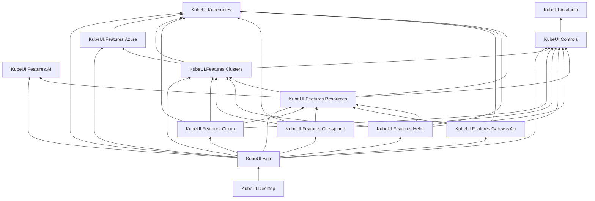

# KubeUI current ownership map

**Status:** Current project and feature ownership map. See [remaining-work.md](remaining-work.md) for the prioritized backlog.

## Project split

The application keeps one project per feature. The existing split is the boundary; do not add paired Core/UI projects, a universal contracts assembly, or move controls wholesale without demonstrated reuse.

| Project | Owns | References |
|---|---|---|
| `KubeUI.Kubernetes` | Kubernetes runtime, model and serialization catalogs, shared non-UI contracts | Runtime dependencies only |
| `KubeUI.Avalonia` | Shared Avalonia foundation, fonts, assets, typography, framework extension provider | No KubeUI project |
| `KubeUI.Controls` | Reusable controls, presentation and docking primitives, shared UI contracts | `KubeUI.Avalonia` only |
| `KubeUI.Features.AI` | AI runtime, chat, MCP feature contracts and views | Controls |
| `KubeUI.Features.Azure` | Azure authentication and management-plane integrations | Kubernetes |
| `KubeUI.Features.Clusters` | Cluster catalog, workspace/session lifecycle, permissions, settings and cluster errors | Controls, Azure, Kubernetes |
| `KubeUI.Features.Cilium` | Cilium/Hubble runtime and UI | Controls, Clusters, Resources, Kubernetes |
| `KubeUI.Features.Crossplane` | Crossplane resource-kind and MR-diff capabilities | Controls, Clusters, Resources, Kubernetes |
| `KubeUI.Features.GatewayApi` | Gateway API resource-kind configurations | Controls, Resources, Kubernetes |
| `KubeUI.Features.Helm` | Helm client, repositories, charts, releases and feature-owned navigation section | Controls, Clusters, Resources, Kubernetes |
| `KubeUI.Features.Resources` | Resource configs/lists, YAML, properties, visualization and Pod workflows | Controls, AI, Clusters, Kubernetes |
| `KubeUI.App` | Shell, navigation, cross-feature composition, application adapters and cluster overview | Kubernetes, Controls, all features |
| `KubeUI.Desktop` | Desktop executable, platform startup and publish configuration | App only |

## Dependency map

### Justified feature dependencies

Feature-to-feature references stay only when the consumer uses an owned capability, and the graph remains acyclic:

- Clusters consumes Azure services for AKS import; Azure does not depend on Clusters.
- Resources consumes Clusters workspace/runtime contracts and AI context capabilities.
- Cilium consumes Clusters lifecycle and Resources-owned graph/icon capabilities.
- Crossplane consumes Clusters resource registration and Resources resource/YAML capabilities.
- Gateway API extends Resources-owned resource configuration capabilities.
- Helm consumes Clusters workspace state and Resources visualization/list/YAML capabilities.

Clusters must not reference Resources. Features must not reference App, Desktop, or the Avalonia foundation. Controls must not reference feature or Kubernetes projects. The Avalonia foundation must not reference another KubeUI project. Desktop references App only.

## Composition and tests

- App composes feature service registrations and provides application-owned adapters. Each feature owns registration for its own services and view factories.
- App owns navigation tab reuse, activation, document IDs and docking. Resources-owned `ResourceListDocumentFactory` creates generic resource documents; `NavigationDocumentService` consumes it instead of constructing ViewModels directly.
- Clusters owns workspace lifecycle and permission refresh through its public workspace facade, with trigger coalescing and debounce in `PermissionRefreshCoordinator`. App owns the cluster overview because it composes Clusters and Resources; `ClusterMetricSnapshotBuilder` produces its immutable gauge values.
- Pod log stream opening, reading, reconnects, cancellation, and reader disposal belong to Resources' `PodLogStreamSession`; `PodLogsViewModel` owns source selection and UI presentation.
- Visualization incremental admission, pending-change coalescing, addition-delta construction, and merge/projection belong to Resources' `VisualizationIncrementalUpdateCoordinator`; `VisualizationViewModel` owns scope state and UI publication.
- Feature tests live in matching `KubeUI.Features.*.Tests` projects. `KubeUI.Avalonia.Tests` owns App shell, shared Controls, Desktop startup, and cross-feature tests. `KubeUI.Testing` owns shared Kubernetes test infrastructure.
- Project-reference boundary and cycle checks live with the shared architecture tests.
